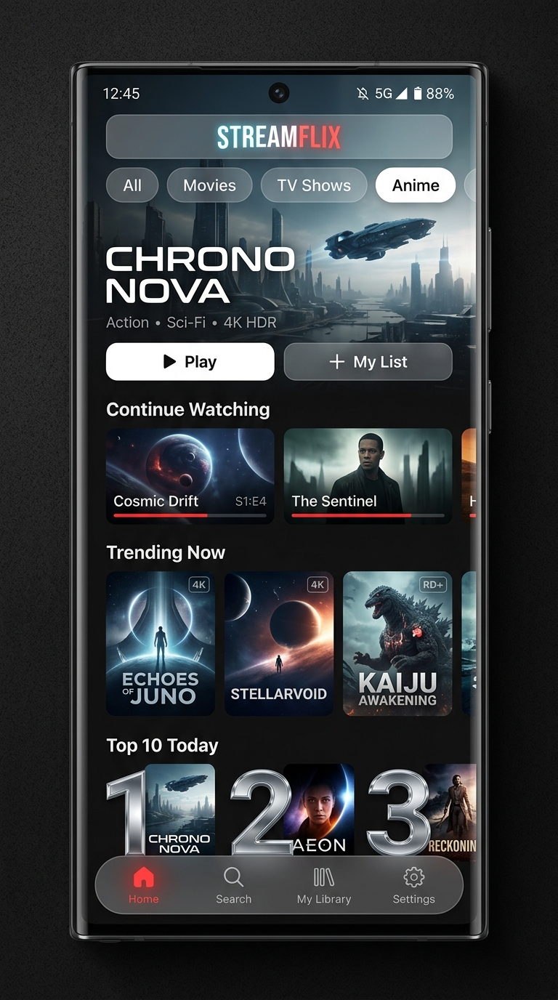
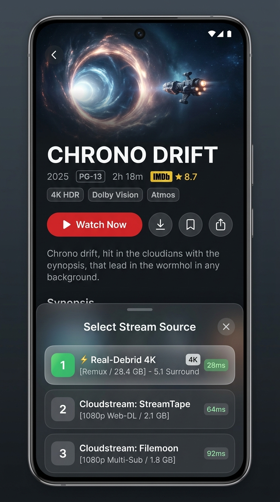
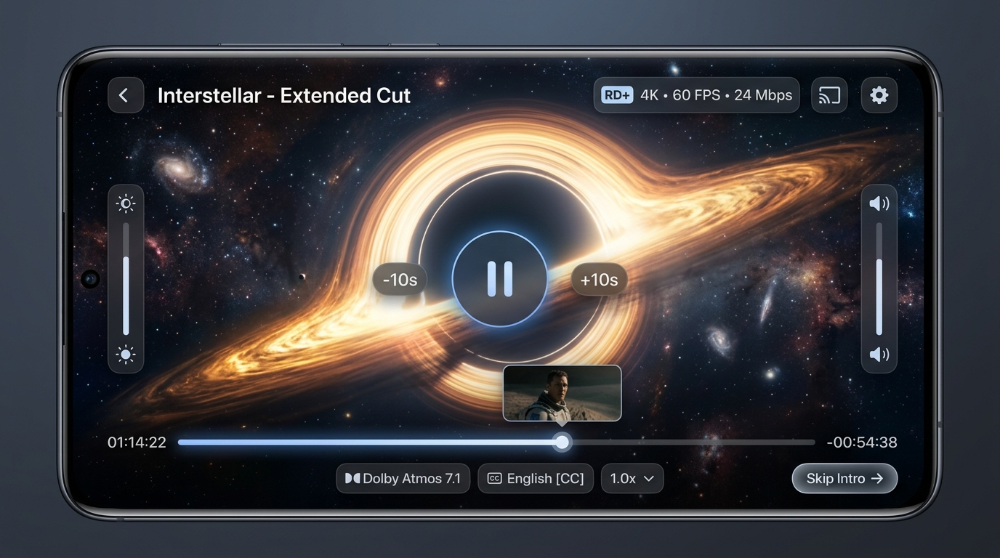

<div align="center">

  

  <h1>Nuvio + Cloudstream Unified</h1>
  <p>
    <b>The Ultimate Open-Source Android Streaming App</b>
    <br />
    Combining <b>Cloudstream's</b> battle-tested multi-host scraping and link extractors with <b>NuvioMobile's</b> modern Compose Multiplatform reactive UI, Stremio/Debrid engine, and centralized metadata.
  </p>

  <p>
    <a href="https://github.com/nikchandanshive05-pixel/NuvioMobile/releases"><b>Download Latest APK</b></a> ·
    <a href="#visual-interface"><b>UI Showcase</b></a> ·
    <a href="#dual-engine-architecture"><b>Architecture</b></a>
  </p>

</div>

---

## 📱 Visual Interface (Netflix Dark Aesthetic)

Designed with Jetpack Compose for Android with a fluid 120Hz refresh rate, deep OLED charcoal `#121212` backgrounds, and official Netflix crimson `#E50914` accents.

| Home Feed | Media Details & Streams | 4K HDR Landscape Player |
| :---: | :---: | :---: |
|  |  |  |

---

## ⚡ Core Highlights

### 1. Dual-Engine Stream Aggregator
* **Cloudstream Native Extractors**: Built-in direct video host resolvers for **StreamTape**, **FileMoon**, **Mixdrop**, **DoodStream**, **Vidplay**, and 100+ others. No remote servers or subscriptions required.
* **Stremio & Debrid Protocol**: Direct support for Stremio community add-ons, HTTP manifests, and cached high-bitrate torrent streams via **Real-Debrid**, **AllDebrid**, and **TorBox**.

### 2. Best-in-Class Playback Engine
* **AndroidX Media3 (ExoPlayer)** with low-latency buffering, hardware decoder passthrough, and custom connection pooling.
* **MPV Native Lib** (`mpv-android-lib`) for complex MKV containers and stylized anime ASS/SSA subtitles.
* **Smart Player Gestures**: Vertical brightness swipe (left), volume swipe (right), double-tap seek (`±10s`), and auto-skip intro.

### 3. Unified Catalog & Tracker Sync
* Full metadata aggregation via **TheMovieDatabase (TMDB)** and **Cinemeta**.
* Two-way scrobbling and watch progress synchronization with **Trakt**, **Simkl**, and **AniList**.

---

## 🛠️ Building & Automated Releases

### GitHub Actions (Instant APK Generation)
This repository includes automated CI/CD workflows under `.github/workflows/build-apk.yml`. 
* Pushing to `build-pipeline` or triggering the **Build Unified Android APK** workflow automatically builds the universal debug APK and creates a downloadable release on GitHub.

### Local Build (Android)
Requires JDK 17+ and the Android SDK:

```bash
./gradlew :androidApp:assembleFullDebug -Pnuvio.android.distribution=full -Pnuvio.ios.distribution=appstore
```

The compiled APK will be generated at:
```
androidApp/build/outputs/apk/full/debug/
```

---

## 📜 License & Credits

* Core frontend & CMP architecture by [NuvioMedia / tapframe](https://github.com/tapframe/NuvioMobile).
* Direct scrapers, link extractors, and resolvers derived from [recloudstream/cloudstream](https://github.com/recloudstream/cloudstream).
* Licensed under the [GNU General Public License v3.0](./LICENSE).
